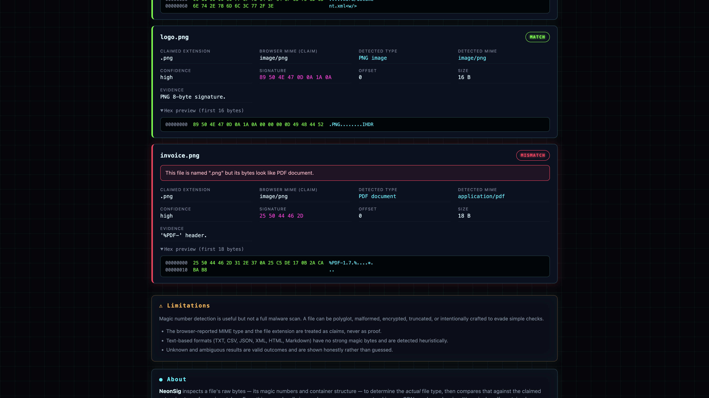
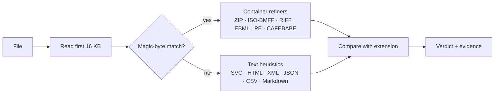

# NeonSig

[](https://github.com/atahan99/NeonSig/actions/workflows/test.yml)

Find out what a file really is. NeonSig reads a file's first bytes in your browser, identifies the format from its magic number and container structure, and tells you when the extension is lying.

**[Try it → neonsig.cybrsmr.xyz](https://neonsig.cybrsmr.xyz)**

<p align="center">
  
</p>

## The problem

Extensions and MIME types are labels anyone can change. Rename `invoice.exe` to `invoice.pdf` and most systems will believe you. Upload filters, mail gateways and file pickers that trust the label are easy to fool.

The bytes are harder to fake. A PDF starts with `%PDF-`, a PNG with `89 50 4E 47`, a Windows executable with `MZ` followed by a PE header. NeonSig checks those bytes and compares the answer with the name.

## What it does

- **Identifies 40+ formats** across images, documents, archives, audio, video, executables, fonts and databases.
- **Looks inside containers** instead of stopping at "it's a ZIP":
  - DOCX / XLSX / PPTX from their internal part names
  - ODT / ODS / ODP and EPUB from the stored `mimetype` entry
  - APK (`AndroidManifest.xml`) and JAR (`META-INF/MANIFEST.MF`)
  - MP4 / MOV / HEIC / AVIF / M4A from ISO-BMFF `ftyp` brands
  - WAV / AVI / WebP from the RIFF form type
  - WebM vs MKV from the EBML DocType
  - EXE vs DLL from the PE characteristics flag
  - Java class vs Mach-O universal binary, which share the `CAFEBABE` magic
- **Gives one of four verdicts**: `MATCH`, `MISMATCH`, `AMBIGUOUS` or `UNKNOWN`, plus a plain-English sentence explaining why.
- **Shows its evidence**: the matched signature, offset, confidence, the browser-reported MIME type, and a hex dump of the first 128 bytes.
- **Handles large files quickly** because it reads only the first 16 KB via `Blob.slice()`, never the whole file.
- **Exports a JSON report** of every scanned file to the clipboard.

## Privacy

Your files never leave your machine. There is no upload endpoint; the page has no backend at all. NeonSig reads raw bytes and never executes, renders or embeds the file.

That isn't only a promise. The page loads no analytics and no third-party code, and its Content-Security-Policy sets `connect-src 'none'`, so the browser itself refuses any network request the page might try. Open DevTools → Network while scanning and you'll see nothing go out.

## Verdicts

| Verdict | Meaning |
| --- | --- |
| **MATCH** | The extension is a valid one for the detected format. |
| **MISMATCH** | The bytes clearly identify a format, and the extension doesn't belong to it (e.g. a PDF named `.png`). |
| **AMBIGUOUS** | The format is a broad container or a text type, and the specific subtype can't be confirmed from the header. |
| **UNKNOWN** | No signature or text heuristic matched: unsupported, empty, encrypted or truncated. |

## Run it locally

It's a static page (`index.html`, `app.css`, `app.js` and `detect.js`) with no build step and no dependencies.

```bash
git clone https://github.com/atahan99/NeonSig.git
cd NeonSig
open index.html
```

On Linux use `xdg-open index.html`; on Windows, `start index.html`. To serve it over HTTP instead, for example to get the async Clipboard API:

```bash
python3 -m http.server 8000
```

Then visit `http://localhost:8000`.

## How it works



1. **Signature registry.** Each format is one entry: hex patterns, an offset, accepted extensions, and a confidence level. Matches are ranked by confidence, then by pattern length, so the most specific signature wins.
2. **Refiners.** Broad containers get a second pass. The ZIP refiner, for example, walks local file headers inside the 16 KB window and reads entry names. Finding `word/document.xml` turns "ZIP archive" into "Word document".
3. **Text fallback.** If no binary signature matches and the bytes look like text (no NUL bytes, few control characters), lightweight heuristics classify common text formats at low confidence.
4. **Verdict.** The detected type's accepted extensions are compared with the real one. Broad and low-confidence detections become `AMBIGUOUS` rather than a false `MISMATCH`.

All rendered values pass through HTML escaping, so a hostile file name can't inject markup. On top of that, the site's security headers (see [`_headers`](_headers)) set:

- **A strict CSP with no inline code**: `default-src 'none'`, with scripts, styles and images allowed only from the site itself, and no network connections at all.
- **Trusted Types** (`require-trusted-types-for 'script'`): the browser rejects any HTML string written to the DOM unless it goes through the app's single `neonsig` policy, and the only caller of that policy escapes its input.
- Cross-origin isolation of the window and its resources (`COOP` / `CORP: same-origin`), `frame-ancestors 'none'`, `nosniff`, `no-referrer`, and a Permissions-Policy that turns off camera, microphone, location and similar APIs.

## Supported formats

| Category | Formats |
| --- | --- |
| Images | PNG, JPEG, GIF, WebP, BMP, TIFF, ICO, CUR, SVG, AVIF, HEIC/HEIF |
| Documents | PDF, RTF, legacy Office (OLE/CFB), DOCX, XLSX, PPTX, ODT, ODS, ODP, EPUB |
| Archives | ZIP, JAR, APK, RAR 4/5, 7z, GZIP, BZIP2, XZ, TAR |
| Audio | MP3 (ID3 and frame sync), WAV, FLAC, OGG, MIDI, M4A/AAC |
| Video | MP4, MOV, 3GP, AVI, MKV, WebM, MPEG |
| Executables | Windows PE (EXE/DLL), ELF, Mach-O, Java class, WebAssembly |
| Fonts | WOFF, WOFF2, TTF, OTF |
| Text | JSON, XML, HTML, CSV, Markdown, plain text |
| Other | SQLite |

## Limitations

This is a file-type identifier, not a malware scanner.

- Only the first 16 KB are read. Polyglots that hide a second format later in the file, such as a ZIP appended to a JPEG, will be reported as the first format.
- Short magic numbers (`BM`, `MZ`, `ID3`, `BZh`) are ignored when the header reads as text, so a note that starts with "BMW" stays a text file. The trade-off: a binary file that happens to look like text in its first 4 KB won't match those signatures.
- Text formats have no magic bytes, so their detection is heuristic and always reported at low or medium confidence.
- Encrypted, truncated or deliberately malformed files may come back `UNKNOWN`. That is the honest answer.

## Tests

The detection engine lives in [`detect.js`](detect.js), separate from the UI, so it runs under Node too. The suite in [`test/`](test/detect.test.js) builds a small byte fixture for each format and asserts the detected type and verdict. It also includes regression cases for past false positives. It needs Node 20 or newer and nothing else:

```bash
node --test
```

CI runs the same command on every push and pull request.

## Adding a format

Add an entry to the `SIGNATURES` array in `detect.js`:

```js
{ id: "png", label: "PNG image", mime: "image/png", extensions: ["png"],
  patterns: ["89 50 4E 47 0D 0A 1A 0A"], offset: 0, confidence: "high",
  notes: "PNG 8-byte signature." },
```

If the format lives inside a container, extend the matching refiner (`refineZip`, `refineIsoBmff`, `refineRiff`, …) instead. Add a fixture to `test/detect.test.js` either way. Issues and pull requests are welcome.

## License

[MIT](LICENSE) © atahan99
